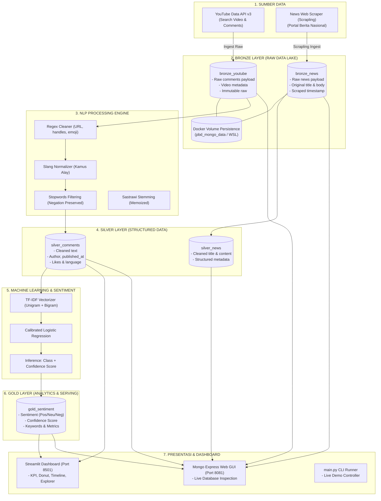

# Arsitektur Data Pipeline Big Data

Proyek: **Analisis Sentimen Publik terhadap Putusan MK terkait Ijazah Gibran**  
Mata Kuliah: **Pengelolaan Big Data — Tugas 1**

---

## 1. Diagram Aliran Data (End-to-End)

---

## 2. Rincian Layer Data (Medallion Architecture)

### 2.1 Bronze Layer (Raw Data)
- **Karakteristik**: *Append-only* dan *immutable* (data tidak dimanipulasi sama sekali dari sumber aslinya).
- **Koleksi**:
  - `bronze_youtube`: Menyimpan JSON response mentah dari YouTube API (struktur `raw` berisi teks asli, nama author, published date, like count).
  - `bronze_news`: Menyimpan payload mentah dari Scrapling scraper (judul asli, paragraf artikel, URL, dan tanggal).
- **Indeks Unik**: `comment_id` dan `url` untuk mencegah duplikasi data jika proses crawling dijalankan ulang.

### 2.2 Silver Layer (Clean & Structured Data)
- **Karakteristik**: Data yang telah melewati pembersihan sintaks, normalisasi singkatan/bahasa gaul media sosial, dan penghapusan *stopword* tanpa menghilangkan kata negasi sentimen.
- **Koleksi**:
  - `silver_comments`: Berisi `text_original`, `text_clean`, `like_count`, `published_at`, `language: id`.
  - `silver_news`: Berisi `title_clean`, `content_clean`, `url`, `author`, `published_at`.

### 2.3 Gold Layer (Analytics & Sentiment)
- **Karakteristik**: Agregasi analitik tingkat bisnis dan hasil prediksi model machine learning yang siap dikonsumsi langsung oleh dashboard.
- **Koleksi**:
  - `gold_sentiment`: Menyimpan `sentiment` (*positive*, *neutral*, *negative*), `confidence` (0.00 - 1.00), probabilitas per kelas, dan metadata interaktif.

---

## 3. Komponen Nilai Tambah

1. **Docker Volume Persistence (Priority 1)**:
   - Volume Docker `pbd_mongo_data` berjalan di lingkungan WSL2.
   - Data tetap utuh dan tersimpan secara permanen bahkan setelah container dimatikan (`docker compose down`) dan dinyalakan kembali.
2. **Web Scraper Modern Scrapling (Priority 1 - Web Data Source)**:
   - Menggunakan library `Scrapling` dengan kemampuan *adaptive parsing* dan *anti-bot protection* (`Fetcher` & `StealthyFetcher`).
3. **Mongo Express GUI (Port 8081)**:
   - Antarmuka web visual untuk membuktikan secara langsung kepada dosen/penilai bahwa dokumen benar-benar tersimpan di MongoDB pada masing-masing layer.
4. **Automated Scheduler (Priority 2)**:
   - Modul `scheduler/scheduler.py` untuk menjalankan crawling dan transformasi secara periodik tanpa intervensi manual.
